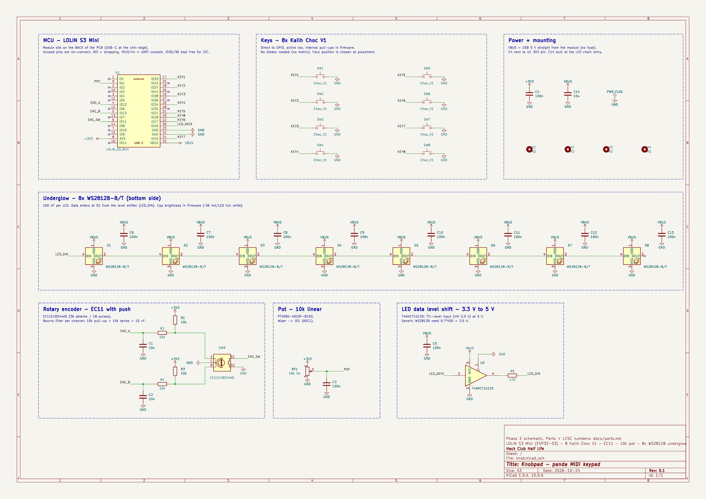
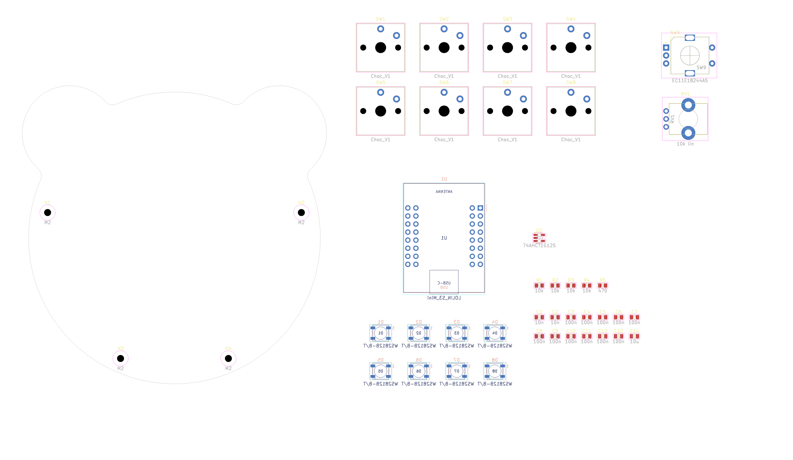
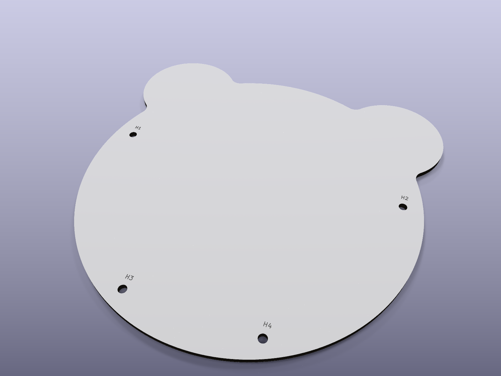

# Phases 2–4 — schematic, footprints, panda outline (done 2026-10-24, waiting for review)

Open `hardware/knob.kicad_pro` in KiCad 10. Pressing **F8 (Update PCB from Schematic)** should report no changes — the board is already in sync (DRC schematic-parity: 0 issues).

| Check | Result | Report |
| --- | --- | --- |
| ERC (all severities) | **0 errors, 0 warnings** | `reports/ERC.rpt` |
| DRC | **0 violations** | `reports/DRC.rpt` |
| Schematic ↔ PCB parity | **0 issues** | `reports/DRC.rpt` |
| Unrouted connections | 88 — expected, routing is Phase 6 | `reports/DRC.rpt` |
| Footprints resolved | 43 / 43 | — |
| Board outline | 1 closed outline, 96.1 × 94.1 mm | — |

Files were saved by KiCad 10.0.6 (schematic format 20260306, board format 20260206 — same as Hushlog).

---

## Phase 2 — Schematic (`hardware/knob.kicad_sch`, A3, one sheet)

Seven blocks, connected with net labels:

| Block | What's in it |
| --- | --- |
| MCU | U1 LOLIN S3 Mini (custom symbol, pins drawn in the physical row order). 14 unused IOs + EN have no-connect flags. |
| Keys | SW1–SW8 Choc V1: GPIO → switch → GND. Internal pull-ups, active low, no diodes. |
| Encoder | SW9 EC11E18244A5. A and B each: 10k pull-up (R1/R3) + 10k series (R2/R4) + 10 nF to GND (C1/C2) — Bourns' filter. C → GND, push switch S1 → IO11, S2 → GND. |
| Pot | RV1 10k linear between 3V3 and GND, wiper → IO1 (ADC1) with 100 nF (C3). |
| Level shift | U2 74AHCT1G125 on 5 V: IO16 (3.3 V) → buffer → R5 470 Ω → D1 DIN. ~OE tied to GND. C5 100 nF. (Decision D1 = yes.) |
| Underglow | D1–D8 WS2812B-B/T daisy-chained, 100 nF each (C6–C13). D8 DOUT unconnected. |
| Power + mounting | C4 100 nF on 3V3, C14 10 µF bulk on VBUS, PWR_FLAG on GND, H1–H4 M2 holes. |

Every part carries hidden `LCSC` and `MPN` fields matching `docs/parts.md`.

**Netlist checked pin by pin against the Phase 1 pin map** (exported netlist vs expected nets, all 14 signal nets + GND/VBUS/3V3 membership + the 7 LED chain links):

| Net | U1 pad | GPIO | Goes to |
| --- | --- | --- | --- |
| POT | 9 | IO1 | RV1 wiper, C3 |
| ENC_A / ENC_B / ENC_SW | 4 / 5 / 6 | IO12 / IO13 / IO11 | R2+C1 / R4+C2 / SW9.S1 |
| KEY1…KEY6 | 17–22 | IO33, IO37, IO38, IO34, IO21, IO17 | SW1…SW6 |
| KEY7 / KEY8 | 24 / 29 | IO15 / IO18 | SW7 / SW8 |
| LED_DATA | 30 | IO16 | U2.A |
| +3V3 / GND / VBUS | 8 / 23, 31 / 32 | — | — |

---

## Phase 3 — Footprints + pin check

| Part | Footprint | Check |
| --- | --- | --- |
| U1 LOLIN S3 Mini | `knob:LOLIN_S3_Mini` (new, custom) | Drawn from Wemos' dimension drawing: 32 pads Ø1.7/1.0 mm, outer rows ±11.43 mm, inner ±8.89 mm, first row 7.7 mm from the antenna end, 25.4 × 34.3 mm outline + USB-C on Fab. Pad n ↔ symbol pin n for all 32. |
| SW1–8 Choc V1 | `knob:SW_Kailh_Choc_V1_1.00u` | Vendored kiswitch footprint, byte-identical to upstream. Pads 1/2 ↔ symbol 1/2. |
| SW9 EC11 | `Rotary_Encoder:RotaryEncoder_Alps_EC11E-Switch_Vertical_H20mm` | Pads A/B/C/S1/S2 ↔ symbol, MP = mounting tabs (no net). |
| RV1 PTV09A-4020F | `Potentiometer_THT:Potentiometer_Bourns_PTV09A-1_Single_Vertical` | **Verified against the Bourns PTV09 datasheet**: one "recommended PCB layout (horizontal/rear mount)" covers both -1 and the bushingless -4 — 3 × Ø1.0 holes over 5.0 mm, Ø2.2 tabs 7.0 mm from the pin row. The footprint matches (pins at 0 / 2.5 / 5.0 mm, tabs at 7.0 mm, Ø2.2). |
| D1–8 WS2812B-B/T | `LED_SMD:LED_WS2812B_PLCC4_5.0x5.0mm_P3.2mm` | Pad 1 VDD, 2 DOUT, 3 VSS, 4 DIN = symbol. |
| U2 74AHCT1G125 | `Package_TO_SOT_SMD:SOT-23-5` | DBV pinout 1 ~OE, 2 A, 3 GND, 4 Y, 5 VCC = symbol. |
| R / C | `R_0805_2012Metric` / `C_0805_2012Metric` | — |
| H1–4 | `MountingHole:MountingHole_2.2mm_M2` | Excluded from BOM (symbol + footprint agree). |

Pin budget still holds: 13 of 27 GPIOs used.

---

## Phase 4 — Panda outline (`hardware/knob.kicad_pcb`)

- **Edge.Cuts**: head circle R 46 mm + two ear circles R 15 mm centred at (±33, −33) mm, joined with four 3 mm fillets (no sharp inside corners for the router). 10 arcs, one closed outline.
- **Size**: 96.1 × 94.1 mm — inside 100 × 100 mm, JLCPCB's cheapest tier.
- **Origin**: grid + drill/place origin at the centre of the head, so every coordinate in Phase 5 is relative to the panda's face.
- **Mounting holes** H1–H4, M2 (Ø2.2 mm, unplated) at (±40, −8) and (±17, +38) mm from the centre. Provisional — they may move a few mm in Phase 5 once the keys are placed.
- **Stackup**: 2 layers, 1.6 mm FR4, HASL lead-free, **white soldermask + black silkscreen** (matches the cover concept; change in Board Setup → Physical Stackup if you want another colour).
- **Net classes**: Default 0.25 mm tracks; **Power** (VBUS, GND, +3V3) 0.5 mm tracks, 0.8/0.4 mm vias.
- All other parts are **staged off-board** (right of the panda) for Phase 5. **U1 and D1–D8 are already flipped to B.Cu** (module and underglow on the back).

## Open for Phase 5 (placement)

- Key positions on the face (ears, eyes, nose, mouth, cheeks) + encoder/pot; then re-check H1–H4 clearances.
- U1 on the back with its USB-C end flush to the chin edge. Keep tracks/pour away from the antenna end if you ever want BLE MIDI.
- 8 LEDs evenly round the back edge for the underglow; C6–C13 next to each LED.
- Standoff height must clear the module stack on the back.
